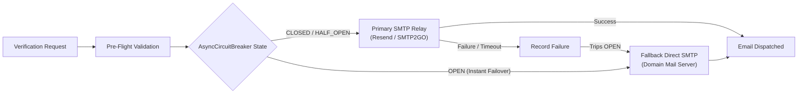

# 🏗️ Architecture, Security & Disaster Recovery

TARVeri is designed with a privacy-first security posture, HMAC-SHA256 blind indexing, authenticated encryption at rest, non-blocking asynchronous I/O, automated failover circuit breakers, and continuous cloud backup.

---

## 📋 Table of Contents
1. [Blind Indexing & Cryptographic Architecture](#blind-indexing--cryptographic-architecture)
2. [Dual-Relay Email & Circuit Breaker](#dual-relay-email--circuit-breaker)
3. [Dead Letter Queue (DLQ) & Background Worker](#dead-letter-queue-dlq--background-worker)
4. [Modular Repository & Domain Architecture](#modular-repository--domain-architecture)
5. [SQLite Concurrency & WAL Checkpoint](#sqlite-concurrency--wal-checkpoint)
6. [Litestream Continuous Cloud Replication](#litestream-continuous-cloud-replication)
7. [Storage Guard & Automated Self-Healing](#storage-guard--automated-self-healing)
8. [Real-Time Telemetry with Sentry](#real-time-telemetry-with-sentry)
9. [Outage Watchdog & Self-Healing](#outage-watchdog--self-healing)
10. [Unicode Normalization & Interaction Timeout Hardening](#unicode-normalization--interaction-timeout-hardening)

---

## 1. Blind Indexing & Cryptographic Architecture

- **HMAC-SHA256 Blind Indexing**: Student IDs and email addresses are hashed with a high-entropy salted secret (`TARVERI_ID_HASH_SECRET`). Lookups and duplicate prevention are executed purely on hashes without storing or querying raw PII. *(Note: Because student IDs have low entropy, `TARVERI_ID_HASH_SECRET` must be kept secret and high-entropy)*.
- **Fernet Authenticated Encryption**: Raw email strings are encrypted with AES-128-CBC + HMAC-SHA256 authenticated symmetric encryption (Fernet) before disk writes.
- **Timing-Attack Resistance**: OTP validation uses `secrets.compare_digest()` for constant-time comparison.

---

## 2. Dual-Relay Email & Circuit Breaker



- **Non-Blocking `aiosmtplib`**: Delivers emails directly on the `asyncio` event loop without thread pool executor overhead.
- **`AsyncCircuitBreaker`**: If Primary SMTP fails 3 consecutive times, it trips **`OPEN`**, instantly routing subsequent verification requests to Fallback SMTP with **0ms timeout penalty**. Probes recovery in **`HALF_OPEN`** after 300s.

---

## 3. Dead Letter Queue (DLQ) & Background Worker

TARVeri integrates an asynchronous Dead Letter Queue (`DeadLetterQueueService` and `tarveri/db/dlq_repo.py`) to prevent transient service interruptions (e.g., SMTP rate limiting, network blips, outbound alert failures) from discarding user operations.

- **Persistent Queue Storage**: Failed tasks are serialized with payload metadata, error traces, and retry attempt counters in the `dead_letter_queue` SQLite table.
- **Exponential Backoff**: Configured with automated interval checks (default 60s) and exponential backoff retry scheduling (`next_retry_at`) up to 5 retries.
- **Poison Pill Isolation**: Once maximum retries are exhausted without success, tasks transition to `DEAD` state, triggering Sentry incident logging for manual administrative review without blocking other queue consumers.

---

## 4. Modular Repository & Domain Architecture

To eliminate God Objects and maintain high maintainability as the codebase expands, TARVeri is organized using modular domain repository and service mixins:

- **Database Repository Mixins (`tarveri/db/`)**:
  - `verification_repo.py`: Student records, profiles, and lifecycle persistence.
  - `guest_repo.py`: Referral codes, review tickets, and vouch records.
  - `settings_repo.py`: Guild configuration, admin channels, and feature toggles.
  - `blacklist_repo.py`: Multi-vector blacklist entries and enforcement.
  - `mass_action_repo.py`: High-impact operation snapshots and rollback states.
  - `uptime_repo.py`: Heartbeat sessions, SLA intervals, and downtime tracking.
  - `dlq_repo.py`: Dead letter queue entries and retry states.
- **Verification Service Mixins (`tarveri/services/verification/`)**:
  - `role_mixin.py`: Faculty and study level role provisioning.
  - `reconciliation_mixin.py`: Server join sync and startup role reconciliation.
  - `moderation_mixin.py`: Unverification and alumni status revocation.
  - `lifecycle_mixin.py`: Card expiry prompts and alumni transition gates.
- **Extracted UI View Modules (`tarveri/views/`)**:
  - `verification_views.py`: Verification modals, OTP prompts, and alumni confirmation views.
  - `guest_views.py`: Gateway panels, application modals, and private review thread views.
  - `admin_views.py`: High-impact confirmation dialogs and mass revocation guards.

---

## 5. SQLite Concurrency & WAL Checkpoint

- **Write-Ahead Logging (`journal_mode=WAL`)**: Allows concurrent reads without blocking writes.
- **Busy Timeout**: Configured with `busy_timeout=15000` (15 seconds) to prevent database lock exceptions during traffic spikes.
- **Clean Checkpoints**: Truncates WAL on startup and shutdown (`PRAGMA wal_checkpoint(TRUNCATE)`).

---

## 6. Litestream Continuous Cloud Replication

TARVeri supports [Litestream](https://litestream.io) for continuous frame-by-frame SQLite streaming to Cloudflare R2 / AWS S3:

```yaml
# litestream.yml
dbs:
  - path: tarveri.db
    replicas:
      - type: s3
        bucket: $LITESTREAM_BUCKET
        path: db
        endpoint: $LITESTREAM_ENDPOINT
        access-key-id: $LITESTREAM_ACCESS_KEY_ID
        secret-access-key: $LITESTREAM_SECRET_ACCESS_KEY
        sync-interval: 10s
        retention: 720h # 30 days
        snapshot-interval: 24h
```

### Operational Modes

1. **Wrapped Execution (Automatic Sync with Bot Process)**:
   ```bash
   # Use -log-level warn to keep terminal logs clean
   litestream replicate -log-level warn -config litestream.yml -exec ".venv/bin/python tarveri_bot.py"
   ```

2. **Decoupled Tmux Panes / Windows**:
   - **Pane 1 (Discord Bot)**: `.venv/bin/python tarveri_bot.py`
   - **Pane 2 (Litestream Daemon)**: `litestream replicate -config litestream.yml`

3. **Systemd Service (24/7 Background Management)**:
   Deploy instantly for any user and directory using the universal installer:
   ```bash
   # User mode (rootless, no sudo required, runs 24/7)
   ./scripts/install_service.sh --user --with-litestream --enable-now

   # Or system-wide mode (requires sudo)
   ./scripts/install_service.sh --system --with-litestream --enable-now
   ```
   - Logs are isolated in `journalctl`:
     ```bash
     journalctl --user -u litestream -f       # Live log tail
     journalctl --user -u litestream -n 50    # Recent 50 log entries
     ```

### Disaster Recovery Commands:
- **List Snapshots**: `litestream snapshots -config litestream.yml tarveri.db`
- **List Generations**: `litestream generations -config litestream.yml tarveri.db`
- **Restore from Cloud**: `litestream restore -config litestream.yml -o tarveri.db`

---

## 7. Storage Guard & Automated Self-Healing

The `StorageGuardService` monitors SQLite database size, WAL/SHM files, local backups, and log directories against configurable thresholds (`TARVERI_MAX_STORAGE_MB`, default 500 MB).

- **Warning Threshold (80%)**: Emits Sentry warning tags and triggers preventive WAL checkpointing (`PRAGMA wal_checkpoint(TRUNCATE)`).
- **Critical Threshold (100%)**: Captures high-priority `StorageLimitExceededError` in Sentry, executes emergency self-healing (WAL truncation, audit log pruning >30 days via `prune_audit_logs()`, and backup rotation).
- **Telemetry**: Continuously reports total storage breakdown in megabytes to Sentry metrics.

---

## 8. Real-Time Telemetry with Sentry

Set `TARVERI_SENTRY_DSN` in `.env` to capture unhandled Discord interaction exceptions, database anomalies, and background task errors in real time.

Test your Sentry setup from the CLI:
```bash
python3 scripts/test_sentry.py
```

---

## 9. Outage Watchdog & Self-Healing

- **Network Probe Daemon**: Tests gateway connectivity and debounces alerts (300s window) during ISP instability.
- **Power Signal Checkpoint**: Captures `SIGPWR` (from UPS daemons) to flush SQLite WAL to disk immediately before shutdown.
- **Self-Healing on Startup**: Auto-recreates deleted roles, discovers valid review channels, and syncs member states.

---

## 10. Unicode Normalization & Interaction Timeout Hardening

Real-world user input and Discord interaction lifecycles are hardened against edge cases:

- **Unicode (NFKC) Normalization**: Student IDs, card expiry dates, OTP codes, and referral codes are normalized using `unicodedata.normalize("NFKC", ...)` to seamlessly handle full-width alphanumeric input from Asian IME keyboards (e.g. `２４ＷＭＤ０１２３４` -> `24WMD01234`).
- **Invisible Character Stripping**: Zero-width spaces (`\u200b`, `\u200c`, `\u200d`, `\ufeff`) and non-breaking spaces (`\xa0`) copy-pasted from mobile devices or PDFs are stripped before regex validation.
- **Line-1 Interaction Deferral**: All Discord UI Modals invoke `await interaction.response.defer(ephemeral=True, thinking=True)` on line 1 of their `on_submit` handlers, eliminating `10062 Unknown interaction` timeout errors if background database queries or regex parsing take longer than 3.0 seconds under heavy load.
- **Resilient Thread Resolution**: Interaction components in Discord review threads resolve parent threads through `_resolve_review_thread` using fallback API fetching if Discord passes partial or `InteractionChannel` objects.
- **Downstream Role Failure Rollback**: If an admin approves a guest ticket but role assignment fails due to bot role hierarchy (`HTTPException`), the ticket status is rolled back to `OPEN` via `reopen_guest_ticket()`, preventing stranded permanently approved tickets.
